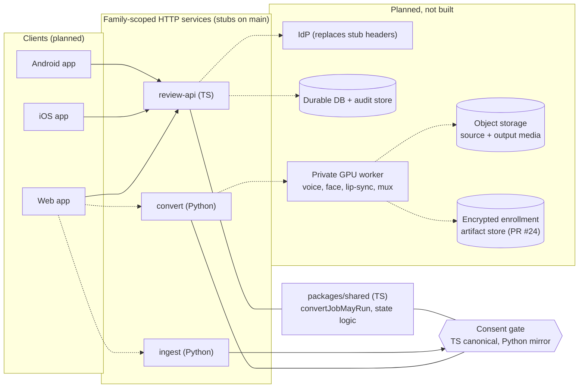
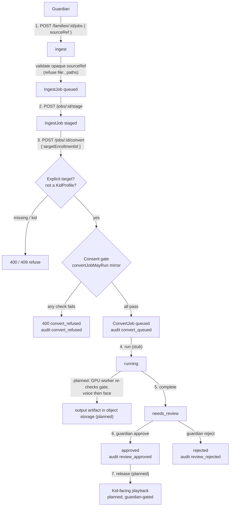
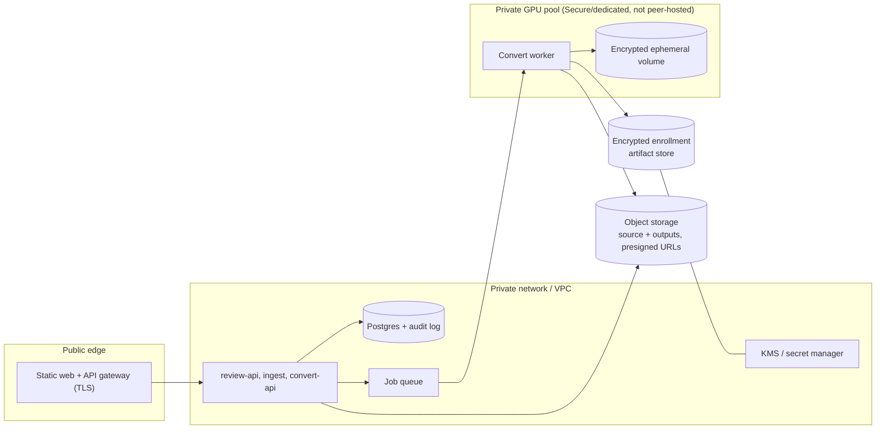

# Architecture

Familiar is a **family-scoped** pipeline: ingest a source video, convert it using an explicitly selected, consented parent enrollment (voice **and** face together, per [ADR 0006](./adr/0006-voice-and-face-together-v1.md)), then require guardian review before kids see anything.

> **Status legend used across these docs**
> **Built (stub)** = exists on `main`, metadata-only, no ML. **Merged in #23/#24** = stub-level, not production; no real capture or models. **Planned** = design intent, nothing exists.
>
> No ML, no biometric capture, no media handling and no production auth exist in this repository today.

Related: [state-machines.md](./state-machines.md) · [data-model.md](./data-model.md) · [api-contracts.md](./api-contracts.md) · [security-and-threat-model.md](./security-and-threat-model.md) · [clients.md](./clients.md) · [ADRs](./adr/README.md)

## 1. Components

| Component | Language | Role | Status |
| --- | --- | --- | --- |
| `packages/shared` | TypeScript | Domain types, canonical `convertJobMayRun`, enrollment/consent/convert-queue state logic, stub auth context, in-memory `AuditLog`, `sourceRef` validation | Built (stub) |
| `apps/review-api` | TypeScript | Guardian API: list/get jobs, approve/reject, revoke/delete enrollment. In-memory store. Never serves media (`501`) | Built (stub) |
| `apps/ingest` | Python | Register opaque external `sourceRef`; `queued → staged \| failed`; hand off to convert with explicit `targetEnrollmentId` | Built (stub): no download, no ffmpeg |
| `apps/convert` | Python | Queue + status stubs; Python mirror of the consent gate | Built (stub): no models |
| Convert backend interface, `MockBackend`, gate-first runner | Python | Pluggable voice-then-face stages; re-checks gate before each backend call | Built (stub), merged in #23 |
| Encrypted enrollment artifact store (AES-256-GCM local impl) | TypeScript | Opaque `artifactRef`, put/get/delete/revoke | Built (stub), merged in #24 |
| Private GPU convert worker (voice conversion, face reenactment/swap, lip-sync, mux) | Python/GPU | Real inference, loads artifacts for **one family** at runtime | Planned |
| Durable DB, durable audit store, object storage for source/output media | n/a | Persistence | Planned |
| IdP / real auth | n/a | Replaces stub headers | Planned, **blocked** |
| Web, iOS, Android clients | TS / Swift / Kotlin | Guardian + capture + review UI | Planned, see [clients.md](./clients.md) |

### Component diagram

Dotted edges are planned. Solid edges exist as in-process or HTTP stubs. Today the three services do not call each other over the network except that ingest imports the convert Python package in-process (`sys.path`) to reuse `queue_convert_job`.

## 2. Trust boundaries

| Boundary | Rule |
| --- | --- |
| Git / CI | Source code only. No media, models, embeddings, secrets ([`git-hygiene` CI job](./development.md#ci-jobs)). |
| Client ↔ API | **Today:** claimed `x-family-id` / `x-guardian-id` headers only (stub; proves nothing). **Planned:** IdP-verified principal. Clients are untrusted: the consent gate is enforced server-side only ([ADR 0009](./adr/0009-client-stack.md)). |
| API ↔ enrollment store | Opaque `artifactRef` only in app records. Artifact bytes live in an encrypted store outside git (local AES-256-GCM stub merged in PR #24; not production, not wired to capture). |
| API ↔ GPU worker | Worker is given a job and re-verifies the gate; it may load artifacts for that job's family only, never logs raw biometrics (planned). |
| Guardian ↔ kid | Kids never approve, never enroll, never call guardian APIs. Preview requires guardian auth (planned; stub returns `501` for media). |

## 3. Data flow: ingest → consent gate → convert → review → release

Notes grounded in code:

- Ingest staging is a **status flip only**; it does not download or transcode ([`stage_ingest_job`](../apps/ingest/src/familiar_ingest/jobs.py)).
- The gate runs at **queue** time in the stubs. The runner merged in PR #23 re-runs it before every backend stage (mock backend only; the HTTP /run stubs do not yet use it).
- `approved` is the only status after which kid release may occur. There is **no release or kid-facing endpoint** in the code; "release" is planned.

## 4. Deployment view (planned)

Everything in this view is **planned**. Constraints already decided: private models only; no public training on family or kids' faces; no third-party inference APIs for biometric data; GPU hosts must be dedicated/secure (see [ADR 0007](./adr/0007-model-choices.md), [security doc](./security-and-threat-model.md)).

## 5. Invariants (all stub-level today, must survive real implementation)

- Family is the tenancy unit; every record carries `familyId`.
- Convert runs only through `convertJobMayRun` (see [state-machines.md](./state-machines.md#convertjobmayrun-exact-checks)).
- Convert targets an **explicit** `targetEnrollmentId` ([ADR 0003](./adr/0003-explicit-target-enrollment.md)); no automatic pairing.
- Kids are never enrollment targets; `KidProfile` is guardian-managed metadata.
- Revoke/delete fail closed; `deleted` is terminal and nulls `artifactRef`.
- Audit is metadata-only; keys that look biometric are rejected.
- Abuse/rate-limit hooks are disabled no-ops and can never override a consent refusal.

## 6. Non-goals

Celebrity/stranger identity paths, public face/voice marketplace, unsupervised kid accounts, cross-family enrollment reuse, shipping weights or media in git, fake JWT/OIDC theater before an IdP is chosen.
