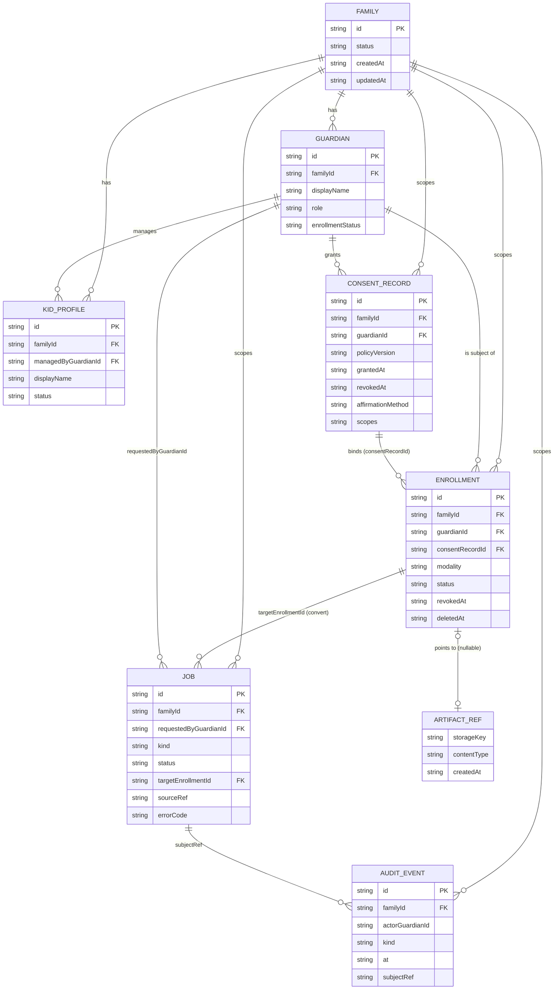

# Data model

Canonical TypeScript types: [`packages/shared/src/types.ts`](../packages/shared/src/types.ts). Python services use dict mirrors. **Built (stub):** types plus in-memory stores only. **Planned:** durable persistence, no schema/migrations exist.

`artifactRef` is embedded in `Enrollment` (not a separate table); it is drawn separately only for clarity. `AUDIT_EVENT.subjectRef` is a loose opaque id (consent, enrollment or job), not a foreign key.

## Entities

All timestamps are ISO-8601 strings (`IsoTimestamp`). All ids are opaque strings.

### Family
`id`, `createdAt`, `updatedAt`, `status: 'active' | 'suspended' | 'deleted'`. Tenancy unit. Invariant: every other record carries its `familyId`; no cross-family reads. (No code currently enforces `suspended`/`deleted` family behavior: planned.)

### Guardian
`id`, `familyId`, `displayName`, `role: 'primary' | 'caregiver'`, `createdAt`, `enrollmentStatus: 'none' | 'pending_consent' | 'enrolled' | 'revoked'`. Only guardians act on a family. `enrollmentStatus` is a type only; nothing updates it yet.

### KidProfile
`id`, `familyId`, `displayName`, `managedByGuardianId`, `createdAt`, `updatedAt`, `status: 'active' | 'archived'`. Invariants: guardian-managed; **never** an enrollment; never a `targetEnrollmentId` (`kid_profile_not_target`); display name only; never used for training.

### ConsentRecord
`id`, `familyId`, `guardianId`, `policyVersion`, `grantedAt`, `revokedAt | null`, `affirmationMethod: 'explicit_ui'` (only value), `scopes: ('voice_enrollment' | 'face_enrollment' | 'inference_on_family_content' | 'guardian_preview')[]`. Invariants: created only via `grantConsent` (non-empty id/family/guardian/policyVersion and ≥1 scope); `revokeConsent` is idempotent and family-checked; revoked consent never passes the gate; account creation or upload is not consent. Note `grantConsent` does not verify that a UI actually showed the text; that is a client/server responsibility ([clients.md](./clients.md)).

### Enrollment
`id`, `familyId`, `guardianId`, `consentRecordId`, `modality: 'voice' | 'face' | 'voice_and_face'`, `status`, `artifactRef | null`, `createdAt`, `revokedAt | null`, `deletedAt | null`. Invariants: state machine in [state-machines.md](./state-machines.md); activation needs bound, same-family, unrevoked, scoped consent; `deleted` ⇒ `artifactRef === null`. v1 product target is `voice_and_face` ([ADR 0006](./adr/0006-voice-and-face-together-v1.md)); the type still allows the other modalities.

### artifactRef (`EnrollmentArtifactRef`)
`storageKey` (opaque key, not a repo path), `contentType`, `createdAt`. A pointer to an encrypted store that does not exist yet (interface proposed in PR #24, not relied on here). Never contains bytes, embeddings or keys.

### Job (IngestJob / ConvertJob share one shape)
`id`, `familyId`, `requestedByGuardianId`, `kind: 'ingest' | 'convert' | 'review'`, `status` (see [state-machines.md](./state-machines.md)), `targetEnrollmentId | null`, `sourceRef | null`, `createdAt`, `updatedAt`, `errorCode | null`.

- **IngestJob:** `kind: 'ingest'`, `targetEnrollmentId: null`, `sourceRef` is a validated opaque external ref (`http`, `https`, `s3`, `gs`, `library`, `external` schemes; rejects empty, `..`, `\`, leading `/` or `./`, missing scheme, unknown scheme such as `file:`).
- **ConvertJob:** `kind: 'convert'`, non-null explicit `targetEnrollmentId`, `sourceRef` copied from the staged ingest job when handed off.
- No output/result reference field exists yet. Where the rendered output lives is **planned** (object storage key on the job or a separate artifact entity).

### AuditEvent
`id`, `familyId`, `actorGuardianId | null`, `kind`, `at`, `subjectRef | null`, `metadata: Record<string, string | number | boolean | null>`. Kinds on `main`: `consent_granted`, `consent_revoked`, `enrollment_revoked`, `enrollment_deleted`, `convert_refused`, `convert_queued`, `review_approved`, `review_rejected` (PR #24 proposes two more). Invariants: validated on append (required fields, known kind, primitive-only metadata, no forbidden biometric/secret-like keys such as `embedding`, `audio`, `face`, `token`, `model`); stored by clone; in-memory, process lifetime, **not durable**. See [audit.md](./audit.md). Note: Python services build audit events as plain dicts with their own mirror log.

### ConvertAbuseHook
`{ status: 'disabled' }`. No-op; cannot override the gate.

## What is never stored

Not in git, not in app records, not in audit metadata, not in logs:

- Raw voice or face samples, crops, spectrograms, frames of enrollees
- Embeddings, voiceprints, face templates, FAISS/ANN indexes
- Model weights and checkpoints
- Source or rendered video/audio
- Secrets: `.env`, API keys, signing keys, cloud credentials, IdP config
- Any kid's face or voice for training (never; and no public-model training on family media at all)

Biometric artifacts, when they exist, live only in the encrypted enrollment store and ephemeral worker volumes (planned). `.gitignore` and the `git-hygiene` CI job enforce the repo side.
