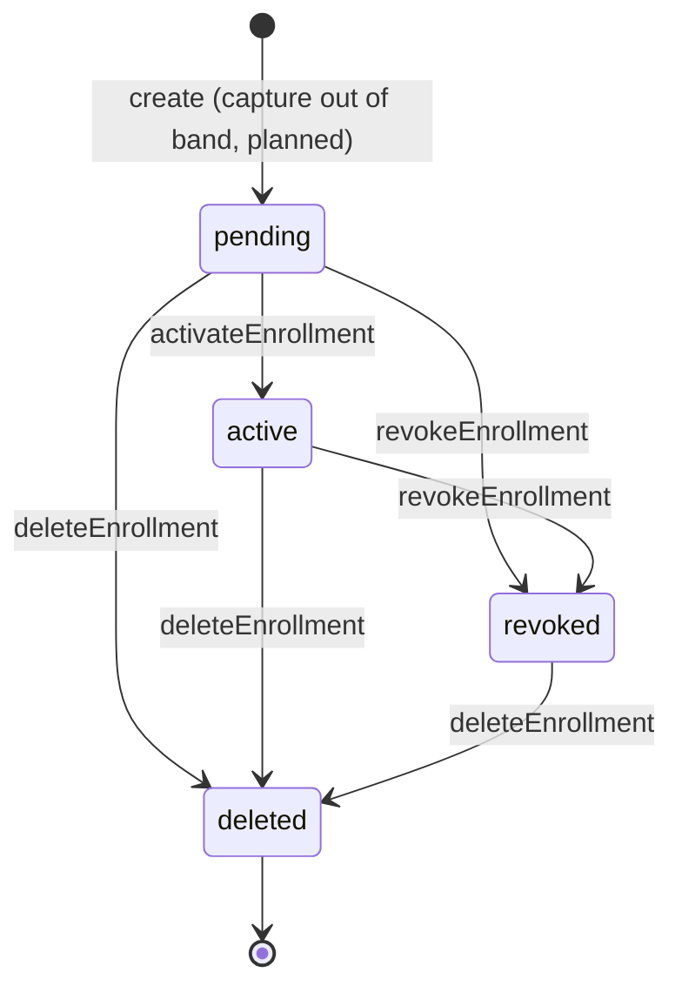
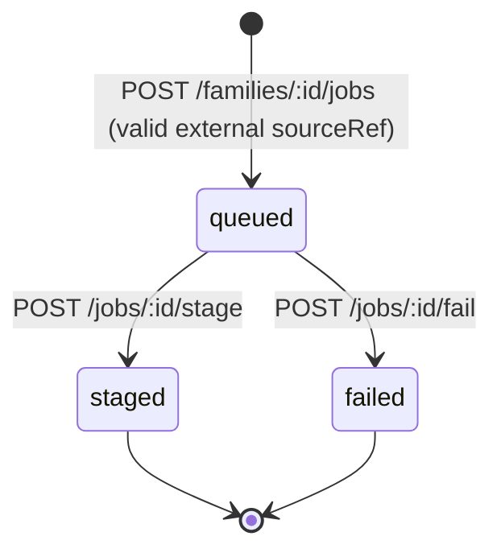
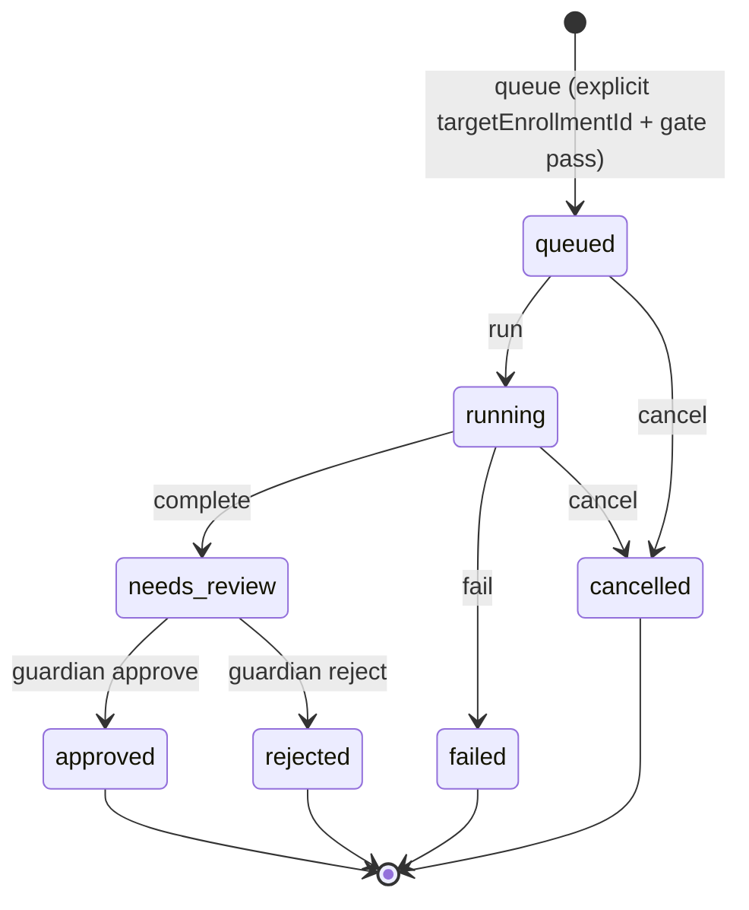

# State machines and gates

All of this is **built (stub)** on `main` unless marked otherwise. Sources: [`enrollment.ts`](../packages/shared/src/enrollment.ts), [`convert-queue.ts`](../packages/shared/src/convert-queue.ts), [`types.ts`](../packages/shared/src/types.ts), [`apps/ingest/.../jobs.py`](../apps/ingest/src/familiar_ingest/jobs.py), [`apps/convert/.../jobs.py`](../apps/convert/src/familiar_convert/jobs.py), [`apps/review-api/src/flow.ts`](../apps/review-api/src/flow.ts).

## 1. Enrollment (`pending → active → revoked | deleted`)

`LEGAL_ENROLLMENT_TRANSITIONS` is exactly: `pending: [active, revoked, deleted]`, `active: [revoked, deleted]`, `revoked: [deleted]`, `deleted: []`.

| Transition | Function | Guards (all fail closed) | Side effects | Error codes |
| --- | --- | --- | --- | --- |
| `pending → active` | `activateEnrollment` | status not `deleted`; legal transition; `enrollment.familyId === consent.familyId` (and optional expected family); `enrollment.consentRecordId === consent.id` **and** `enrollment.guardianId === consent.guardianId`; consent unrevoked; consent scopes include modality scopes (`voice`→`voice_enrollment`, `face`→`face_enrollment`, `voice_and_face`→both) | status `active` | `already_deleted`, `illegal_transition`, `wrong_family`, `consent_not_bound`, `consent_revoked`, `missing_enrollment_scopes` |
| `pending\|active → revoked` | `revokeEnrollment` | not `deleted`; optional family match; already `revoked` is an idempotent success | status `revoked`, `revokedAt` set | `already_deleted`, `wrong_family`, `illegal_transition` |
| `pending\|active\|revoked → deleted` | `deleteEnrollment` | optional family match; already `deleted` is idempotent (re-nulls `artifactRef`) | status `deleted`, `deletedAt` set, `revokedAt` defaulted to `at`, **`artifactRef = null`** | `wrong_family`, `illegal_transition` |

Illegal by design: anything → `pending` (create-only); `deleted → *` (terminal); `revoked → active` (no reactivation, create a new enrollment). Deleting artifact **bytes** in the encrypted store is planned (interface proposed in PR #24); today only the pointer is nulled.

Consent revocation (`revokeConsent`) does **not** mutate enrollments. Convert fails closed because `convertJobMayRun` checks consent directly. [consent.md](./consent.md) describes related enrollments becoming `revoked`; that cascade is **not implemented** in code (planned).

## 2. Ingest job (`kind: 'ingest'`)

| Transition | Guards | Error codes |
| --- | --- | --- |
| create → `queued` | non-empty guardian+family (stub auth); `is_external_source_ref` | `missing_guardian`, `missing_family`, `invalid_source_ref` |
| `queued → staged` | job exists, kind `ingest`, same family, status `queued`, sourceRef still valid | `not_found`, `wrong_family`, `illegal_job_status`, `invalid_source_ref` |
| `queued → failed` | same as above; `errorCode` from body, default `staging_failed` | `not_found`, `wrong_family`, `illegal_job_status` |

Only a `staged` ingest job can hand off to convert (`illegal_job_status` otherwise). Handing off does not change the ingest job's status.

## 3. Convert job (`kind: 'convert'`)

| Transition | Where | Guards | Error codes |
| --- | --- | --- | --- |
| create → `queued` | convert `POST /families/:id/jobs`; ingest `POST /jobs/:id/convert` | non-blank `targetEnrollmentId`; id is not a `KidProfile`; enrollment exists; consent exists; gate passes | `missing_target_enrollment`, `kid_profile_not_target`, `convert_refused` |
| `queued → running` | convert `/run` | kind convert, same family, status `queued` | `not_found`, `wrong_family`, `illegal_job_status` |
| `running → needs_review` | convert `/complete` | status `running` | same |
| `running → failed` | convert `/fail` | status `running`; default errorCode `convert_failed` | same |
| `queued\|running → cancelled` | convert `/cancel` | status `queued` or `running` | same |
| `needs_review → approved \| rejected` | review-api `/approve`, `/reject` | job exists, same family, status `needs_review` | `not_found`, `wrong_family`, `illegal_job_status` |

`JobStatus` also contains `staged` (ingest only). `JobKind` includes `review`, but no code creates review-kind jobs.

Note: the stub `/run` and `/complete` endpoints do **not** re-check the gate (it runs at queue time). PR #23 proposes a gate-first runner that does; treat re-checking before every stage as a requirement for any real worker ([ADR 0002](./adr/0002-ts-canonical-gate-python-mirror.md)).

## `convertJobMayRun` exact checks

TypeScript (canonical) `convertJobMayRun(job, enrollment, consent)` returns `false` unless **all** hold, evaluated in this order:

1. `job.kind === 'convert'`
2. `job.targetEnrollmentId === enrollment.id`
3. `job.familyId === enrollment.familyId` **and** `job.familyId === consent.familyId`
4. `enrollment.consentRecordId === consent.id`
5. `consent.revokedAt === null`
6. `enrollment.status === 'active'`
7. `consent.scopes` includes `inference_on_family_content`

It does **not** require `job.requestedByGuardianId === enrollment.guardianId` (in-family selection, [ADR 0003](./adr/0003-explicit-target-enrollment.md)). It does not check `consent.guardianId === enrollment.guardianId`, nor that the consent includes `voice_enrollment`/`face_enrollment` at convert time (that is enforced at activation).

Python mirror `queue_convert_job(request)` raises `ConvertRefused` in this order: empty `enrollment_id`; enrollment family ≠ job family; consent family ≠ job family; `enrollment_consent_id ≠ consent_id`; consent revoked; enrollment status ≠ `active`; missing `inference_on_family_content`. Then the (disabled) abuse hook runs, which can only further refuse. Python has no `kind` check and no `targetEnrollmentId`-equals-enrollment check at this layer; callers look the enrollment up by the target id. Cross-language cases: [`convert-gate-cases.json`](../packages/shared/fixtures/convert-gate-cases.json). See [consent-gate.md](./consent-gate.md).
