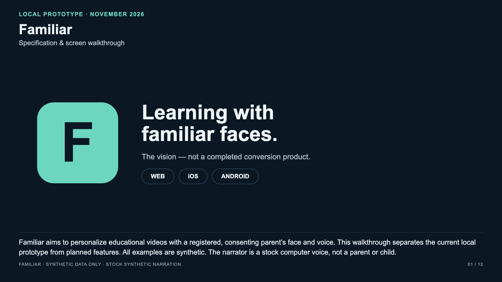

# Familiar — specification, screens and user flow

[Watch / download the video](familiar-walkthrough.mp4) · [Full transcript](TRANSCRIPT.md) · [Chapter timings](chapters.json)

**3 min 53 sec · 1920 × 1080 · H.264 video + AAC audio · 6.28 MB**

Created on 2026-11-04 at the owner's explicit request to store one walkthrough video in the Familiar GitHub project. It is a narrated, captioned sequence of screen captures and explanatory slides, not a live continuous recording.

## What is shown

- Actual running local web screens: Home, Dev settings, Review job list and job details, using only `fam_demo`, `guardian_demo`, and synthetic job/enrollment identifiers.
- Native fixture, development connection, and review screens: clearly labeled **illustrations based on SwiftUI/Compose source**, not device captures or verified native flows.
- Planned guardian sign-in, explicit consent, enrollment, conversion, preview/review, and child playback: clearly labeled illustrative wireframes, not shipped screens.
- Current implementation, test evidence and remaining limitations. No real authentication, enrollment capture, conversion, playback or release is implied.

## Scope and provenance

The actual screenshots were captured from the local `codex/guardian-review` continuation of [PR #30](https://github.com/sunveda/familiar/pull/30), based on `642a606` and including the later local guardian-review work. That application work remains separate and unpublished. **This documentation branch does not contain the implementation shown in the local captures.** This video is a dated progress artifact, not evidence that `main` or a deployment has these screens.

The 205 passing npm tests and Swift API smoke checks cited in the video belong to that local implementation. The full SwiftUI build is blocked by missing tooling; XCTest and Android tooling are unavailable. Native HTTPS/network/device flows have not been verified. Real family use remains blocked by authentication, persistent consent/enrollment and media-pipeline prerequisites.

All text, IDs and images are synthetic product material. Narration uses the stock macOS Samantha text-to-speech voice. No parent or child face, personal voice recording, biometric material, private media or secret is included.

## Playback verification

- Both final streams fully decoded with FFmpeg without errors.
- Browser playback/seek checks cover the beginning, web screens, native illustrations and closing section.
- All 12 frame layouts were rendered at 1080p; representative actual/native/planned frames were visually checked for clipping and legibility.
- MP4 uses fast-start metadata; narration is AAC. Visible captions and a text transcript accompany the narration.

SHA-256: `ab67275e2dfd2c42b013f2fd22f521fe6f7ddfdbb02d113f20163b4e9471156e`

The `.gitignore` and CI media guard exception is restricted to this exact owner-requested synthetic walkthrough file. All other media/biometric exclusions remain in place. Nothing is merged or deployed by adding this branch.
